# DevOps Capstone Project - Execution Output

## Project Overview
**Objective:** Deploy a React application to AWS EC2 using Docker, Jenkins CI/CD pipeline, bash automation scripts, and open-source monitoring tools (Prometheus & Grafana).

**GitHub Repository:** https://github.com/Lakshmiparamesh/DevOps-Capstone  
**Application:** OnlineShop (React e-commerce app)  
**Live URL:** http://3.110.196.46  
**Jenkins URL:** http://3.110.196.46:8080  
**Prometheus URL:** http://3.110.196.46:9090  
**Grafana URL:** http://3.110.196.46:3000  

---

## 1. AWS Infrastructure Setup

### EC2 Instance
- **Instance Type:** t2.micro (Free Tier eligible)
- **AMI:** Ubuntu 22.04 LTS
- **Region:** ap-south-1 (Mumbai)
- **Storage:** 20GB gp3 EBS volume
- **Key Pair:** devops-capstone-key

### Security Groups
| Port | Protocol | Source | Purpose |
|------|----------|--------|---------|
| 22 | TCP | My IP | SSH Access |
| 80 | TCP | 0.0.0.0/0 | Application (HTTP) |
| 8080 | TCP | 0.0.0.0/0 | Jenkins |
| 9090 | TCP | 0.0.0.0/0 | Prometheus |
| 3000 | TCP | 0.0.0.0/0 | Grafana |

### Terraform
Infrastructure provisioned using Terraform with the following resources:
- `aws_security_group.app_sg` — Security group with required ports
- `aws_instance.app_server` — EC2 instance with user_data bootstrap script

---

## 2. Docker Configuration

### Dockerfile
Multi-stage build using `nginx:1.25-alpine` as base image:
- Serves React production build files from `/usr/share/nginx/html/`
- Custom nginx.conf for SPA routing (try_files for React Router)
- Exposes port 80

### Docker Compose
- Service: `app` using `lakshmiparamesh/devops-capstone-dev:latest`
- Port mapping: `80:80`
- Health check configured with curl
- Auto-restart policy: `unless-stopped`

### DockerHub Repositories
- **Dev:** `lakshmiparamesh/devops-capstone-dev` (Public)
- **Prod:** `lakshmiparamesh/devops-capstone-prod` (Private)

---

## 3. Bash Automation Scripts

### build.sh
- Detects current Git branch
- Routes to appropriate DockerHub repository:
  - `master`/`main` branch → `devops-capstone-prod`
  - Other branches (e.g., `dev`) → `devops-capstone-dev`
- Builds Docker image with commit SHA tag
- Tags image as `latest`

### deploy.sh
- Pushes Docker image to DockerHub
- Runs `docker compose down` and `docker compose up -d`
- Performs HTTP health check on port 80

---

## 4. Jenkins CI/CD Pipeline

### Jenkins Setup
- **Version:** Jenkins 2.580.2 (LTS)
- **Installation:** WAR file at `/opt/jenkins/jenkins.war`
- **Plugins:** Git, Docker Pipeline, Docker Commons, Credentials, Pipeline

### Jenkinsfile (Declarative Pipeline)
5-stage pipeline:

| Stage | Description |
|-------|-------------|
| **Checkout** | Clones repo from GitHub |
| **Determine Branch** | Detects branch and selects DockerHub repo |
| **Docker Build** | Builds Docker image with commit SHA tag |
| **Docker Push** | Pushes image to appropriate DockerHub repo |
| **Deploy** | Runs docker compose up and health check |

### Build Results
- **Build #1:** Failed at Docker Push stage (credential issue — fixed)
- **Build #2:** SUCCESS — All 5 stages passed ✓

---

## 5. Monitoring Setup

### Prometheus (v2.47.2)
- Scrapes metrics from Node Exporter and itself
- Targets: `node` (port 9100), `prometheus` (port 9090)
- Available at port 9090

### Node Exporter (v1.7.0)
- Collects system metrics (CPU, memory, disk, network)
- Running on port 9100

### Grafana (v10.2.2)
- Connected to Prometheus as data source
- Custom dashboard: "EC2 Node Monitoring" with 4 panels:
  - CPU Usage (timeseries)
  - Memory Usage (timeseries)
  - Disk Usage (gauge)
  - Network Traffic (timeseries)

---

## 6. Screenshots

### Jenkins
| Screenshot | Description |
|-----------|-------------|
| 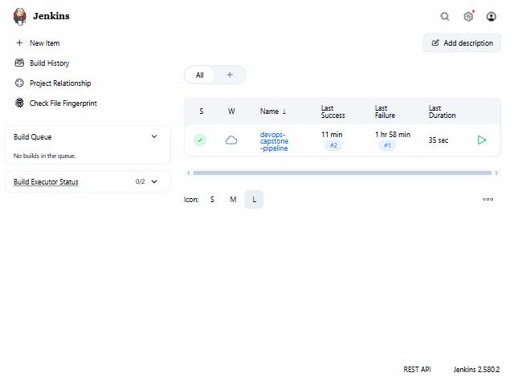 | Jenkins main dashboard showing pipeline job |
| 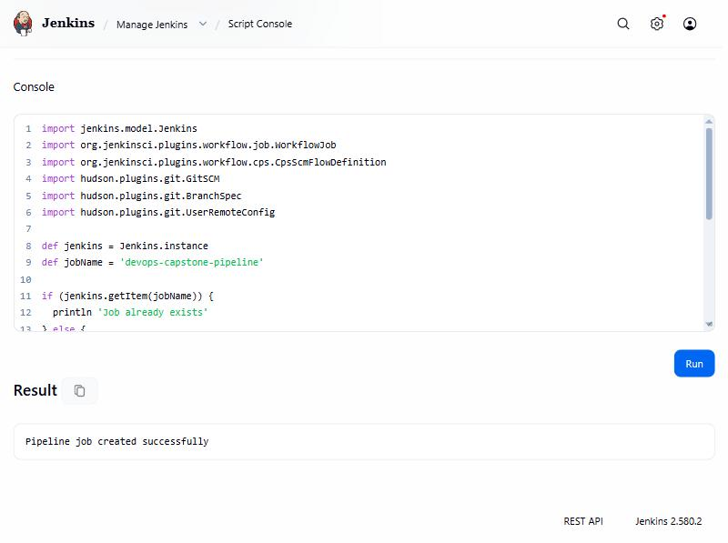 | Pipeline job configuration |
| 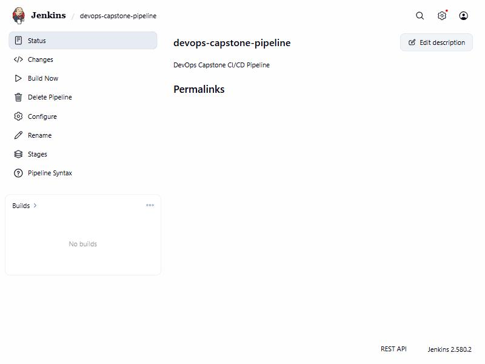 | Pipeline job view |
| 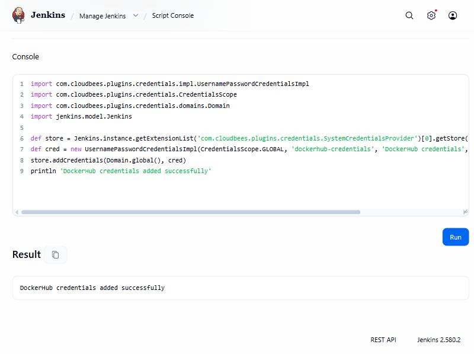 | DockerHub credentials configured |
| 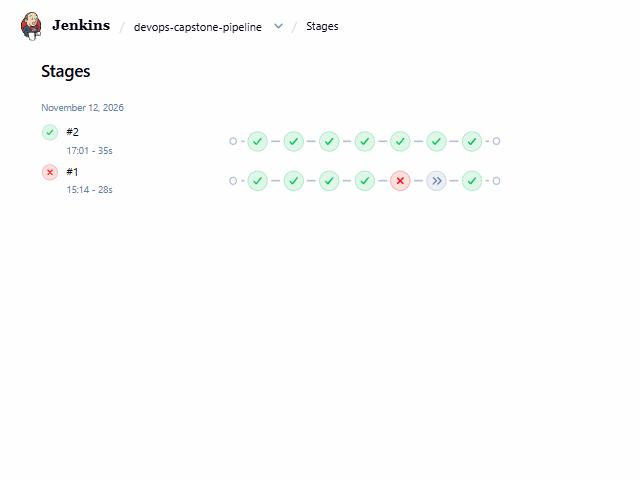 | Pipeline stages — Build #2 all green |
| 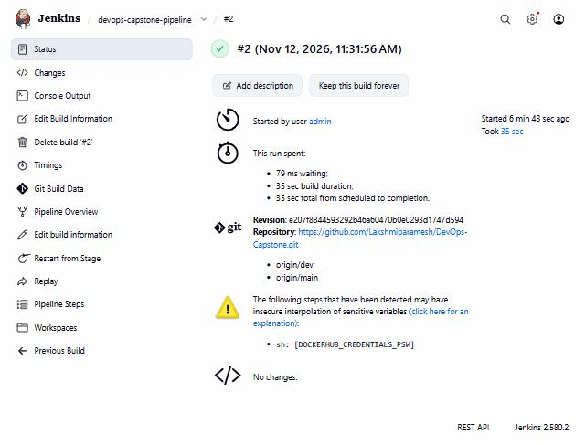 | Build #2 details — SUCCESS in 35 sec |
| 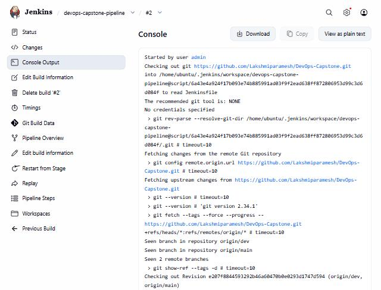 | Build #2 console output (start) |
| 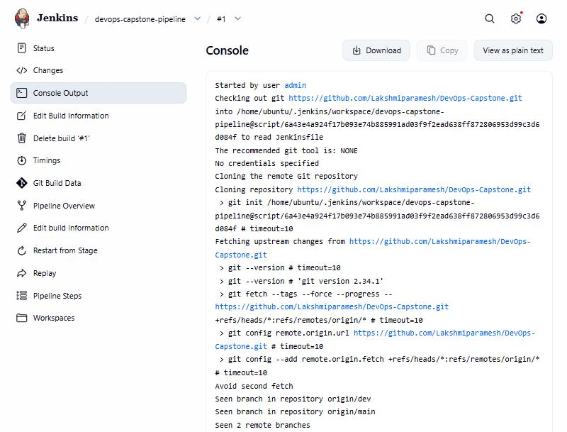 | Build #1 console output |

### Application
| Screenshot | Description |
|-----------|-------------|
| 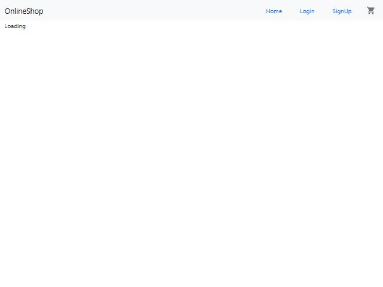 | React app live at http://3.110.196.46 |

### DockerHub
| Screenshot | Description |
|-----------|-------------|
| 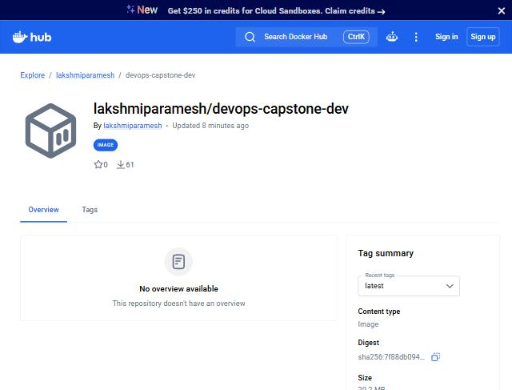 | DockerHub dev repository |
| 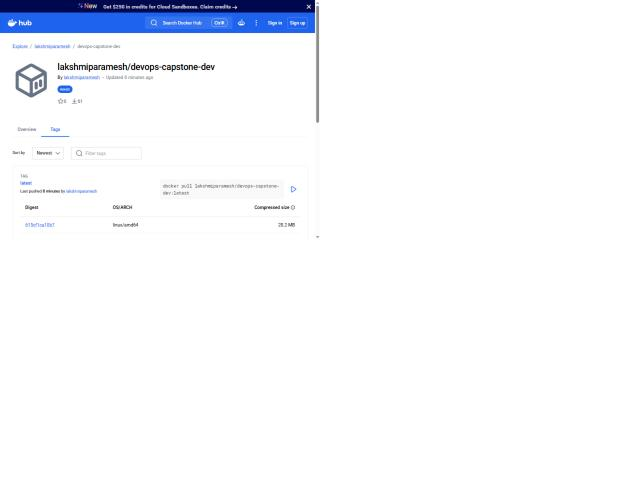 | Docker image tags (latest, commit SHA) |

### Monitoring
| Screenshot | Description |
|-----------|-------------|
| 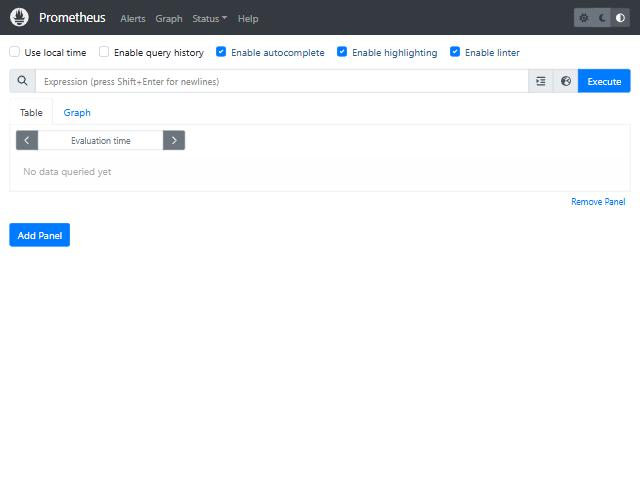 | Prometheus query interface |
| 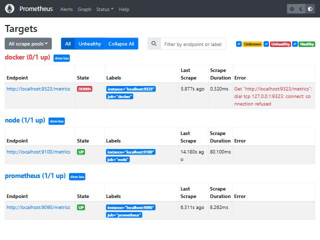 | Prometheus scrape targets (node UP, prometheus UP) |
| 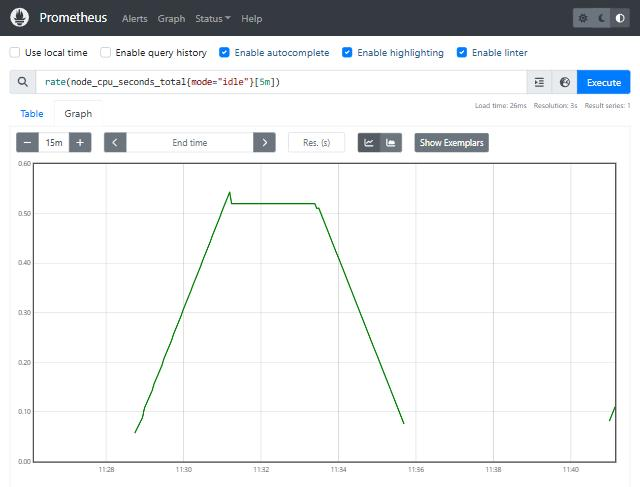 | CPU idle rate graph in Prometheus |
| 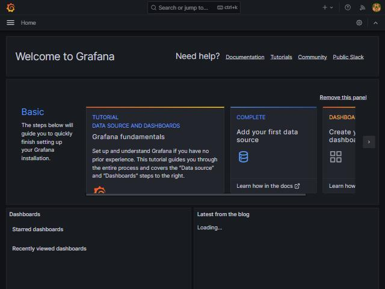 | Grafana home page |
| 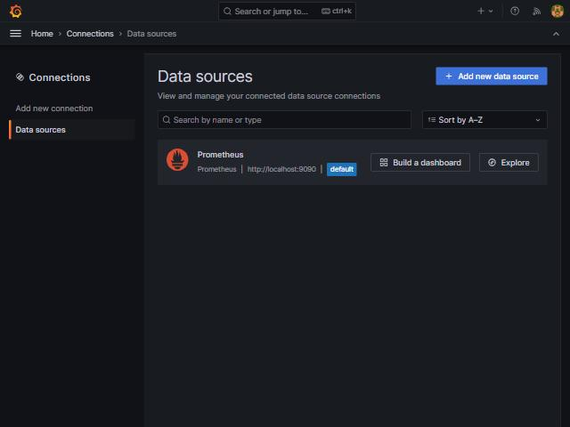 | Prometheus data source configured |
| 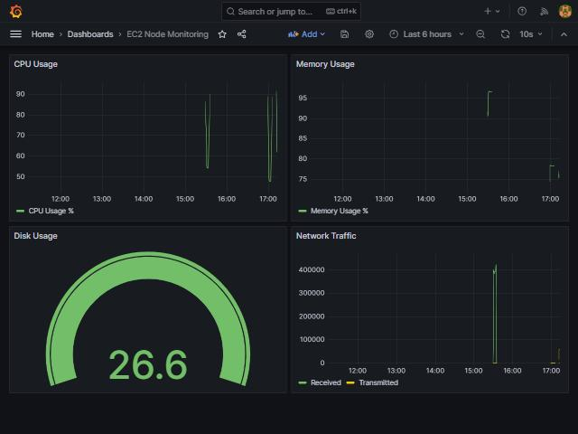 | EC2 Node Monitoring dashboard |

---

## 7. Project Structure

```
DevOps-Capstone/
├── Dockerfile              # Nginx-based container for React app
├── docker-compose.yml      # Docker Compose orchestration
├── nginx.conf              # Nginx SPA routing config
├── Jenkinsfile             # Declarative CI/CD pipeline
├── build.sh                # Docker build automation script
├── deploy.sh               # Docker push & deploy script
├── build/                  # React production build files
├── terraform/
│   ├── main.tf             # Terraform provider config
│   ├── variables.tf        # Variable definitions
│   ├── ec2.tf              # EC2 instance resource
│   ├── security-groups.tf  # Security group rules
│   └── outputs.tf          # Output values
├── screenshots/            # All execution screenshots
└── EXECUTION-OUTPUT.md     # This document
```

---

## 8. Key Technical Decisions

1. **Nginx Alpine** — Lightweight container (~28MB) for serving static React files
2. **Branch-based routing** — `main`/`master` → prod DockerHub, `dev` → dev DockerHub
3. **Swap file** — 1GB swap on t2.micro to prevent OOM with Jenkins + monitoring
4. **Monitoring disabled by default** — Prometheus/Grafana stopped when not needed to conserve memory on t2.micro

---

## 9. How to Reproduce

```bash
# 1. Clone the repository
git clone https://github.com/Lakshmiparamesh/DevOps-Capstone.git
cd DevOps-Capstone

# 2. Provision infrastructure
cd terraform
terraform init
terraform apply

# 3. SSH into EC2 and verify services
ssh -i devops-capstone-key.pem ubuntu@<EC2_PUBLIC_IP>
systemctl status jenkins docker

# 4. Access Jenkins at http://<EC2_PUBLIC_IP>:8080
# 5. Trigger pipeline build
# 6. Access app at http://<EC2_PUBLIC_IP>

# 7. Start monitoring (when needed)
sudo systemctl start prometheus node_exporter grafana-server
# Access Prometheus at :9090, Grafana at :3000
```
